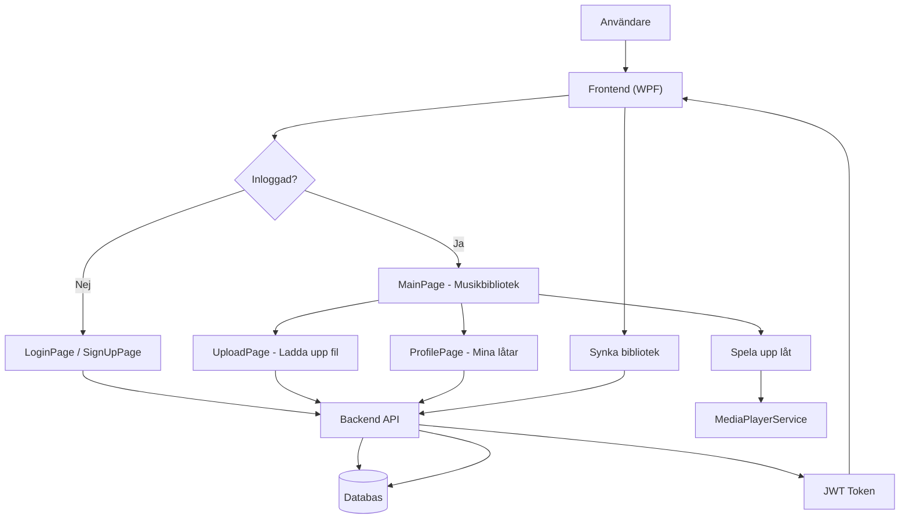

# TUNE - Music Player

## Kort beskrivning
Tune är ett musikhanteringssystem där du kan ladda upp, lagra, spela upp och dela egna ljudfiler, även sånt som inte finns på stora streamingplattformar. Projektet består av en WPF-klient och ett ASP.NET Core API.

## Projektstruktur (kort)
- Backend: ASP.NET Core API med `SongsController` och modellen `Song`.
- Frontend: WPF med sidorna `LoginPage`, `SignUpPage`, `MainPage`, `ProfilePage`, `UploadPage`.
- Tjänster: `ApiClient` för API-anrop och `MediaPlayerService` för uppspelning.

## Produktmål
- Ladda upp egna ljudfiler och hantera metadata.
- Spela upp musik med en enkel, tydlig spelare.
- Synka biblioteket mellan flera enheter via API.

## MVP
- Uppladdning av lokala musikfiler.
- Lista över uppladdade filer med grundläggande metadata.
- Enkel musikspelare med play/pause, tidslinje och hopp i låt.
- Konto och inloggning med användarnamn/e-post och lösenord.
- Grundläggande synkning mellan enheter.

## Användarresa (kort)
1. Skapa konto och logga in.
2. Ladda upp ljudfiler från enheten.
3. Se biblioteket på `MainPage` och spela upp musik.
4. Hantera egna låtar på `ProfilePage` (lista, spela, radera).
5. Logga in på ny enhet och få samma bibliotek.

## Flödesschema

## Tekniköversikt
- Backend: ASP.NET Core API (.NET 9)
- Frontend: WPF (.NET 9)
- Auth: JWT
- Kommunikation: REST

## Authentication (JWT)
- Backend endpoints: `POST /auth/register`, `POST /auth/login`, `GET /auth/me` (protected).
- Konfiguration: `Jwt` i `Backend/appsettings.Development.Local.json` (ersätt `REPLACE_THIS_WITH_A_STRONG_RANDOM_SECRET`).
- Frontend: `LoginPage` och `SignUpPage` anropar backend. `BackendApiBaseUrl` i `Frontend/AppConfig/appsettings.Development.Local.json` (default `http://localhost:5000`).
- Tokens lagras i minnet och bifogas automatiskt via `Frontend/Services/ApiClient.cs`.

## Andra endpoints
- `GET /users` (listar användare).
- `GET /songs` (hämtar alla låtar via minimal API).

